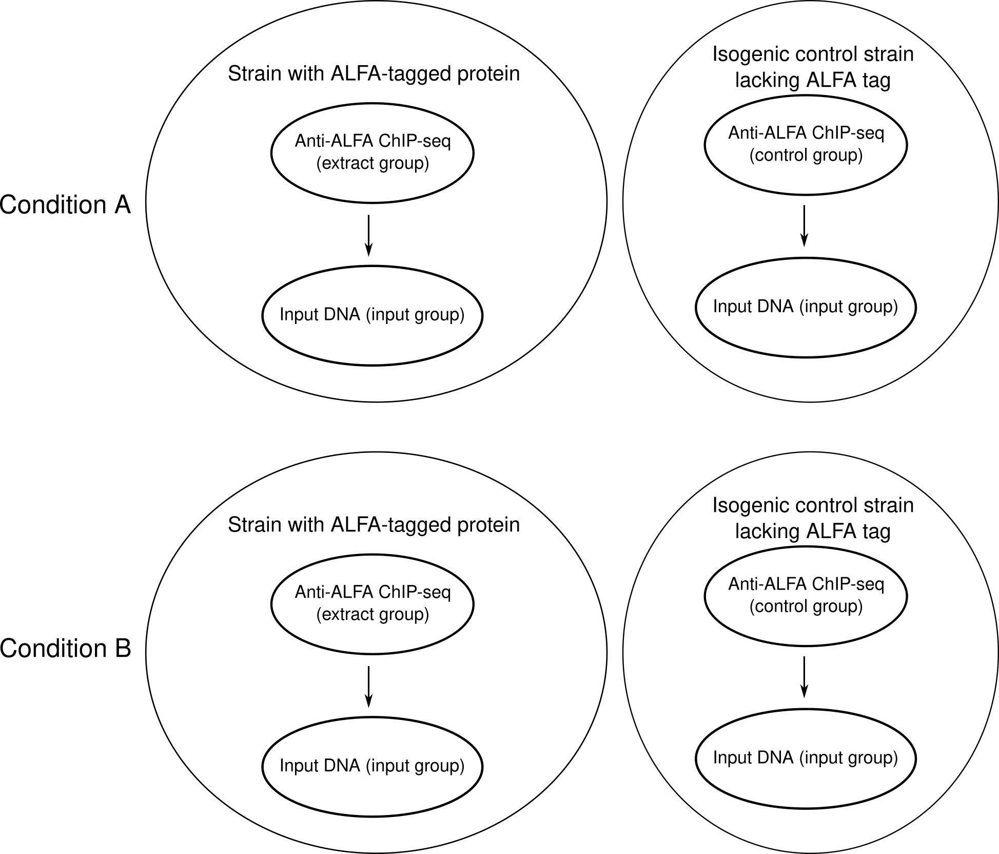
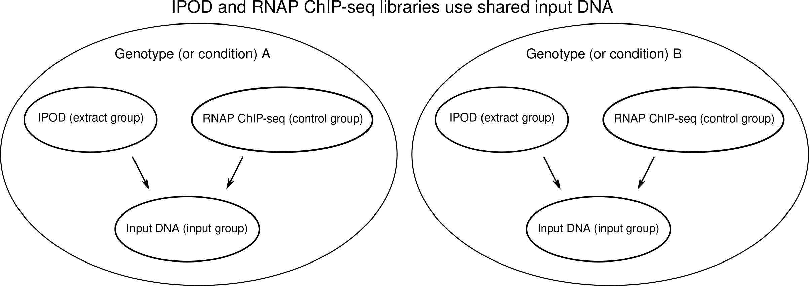

# Enricherator

A set of tools to use Bayesian inference to infer enrichment
of sequencing fragments in an extracted sample, i.e.,
Chip-seq, IPOD-HR, HBD-seq, etc., vs. input DNA fragments.

We note that Enricherator takes the term "sequencing fragments"
seriously. Its statistical model works well for count data that quantify alignments of
paried-end sequencing fragments. If you have single-end data, you must
estimate the fragment size and extend the 3-prime ends of your
alignments by the appropriate ammount to count pseudo-fragments.

This version (v 1.0.0) of Enricherator is a substantial improvement over the
version most recentply published in JMB[^1], and of course, its original implementation on HBD-seq data[^2].
Version 1.0.0 has the following benefits:

* Uses median read count normalization instead of a trimmed mean.
  Empirically, we have found that this just works much better, as mean normalization often resulted
  in enrichment estimates that were systematically shifted by a baseline factor. Median normalization
  does not have this problem.
* MUCH lower memory usage during post-fit steps
* Better use of shrinkage prior, user now specifies their prior belief for the fraction of the genome truly
  enriched in both their control data and their experimental (often called "extract" below) data
* Able to handle arbitrary contrasts between conditions
* Can subtract control enrichments from the experimental enrichments. For example, if, in a ChIP-seq experiment,
  the ChIP-seq against a protein of interest (we'll call this the "experimental ChIP-seq"),
  a ChIP against a strain knocked out for the protein of interest (we'll call this the "control ChIP-seq"),
  and input sequencing for both the expeperimental and control ChIP-seq, were performed,
  the enrichments inferred in the control ChIP-seq relative to its input signal
  can be subtracted from the enrichments inferred for the experimental ChIP-seq relative to its input signal.
  This is useful for removing spurious enrichments that have nothing to do with the actual signal of interest,
  so that genomic loci with spurious enrichments are not considered in downstream analyses.
  We often use it to subtract RNAP ChIP-seq signals from our IPOD signals to generate IPOD-HR
  signals.

## Enricherator workflow

Enricherator uses bedgraph files (in the near future we look forward to
supporting use of bigwig files)
containing fragment counts to infer enrichments.
To use enricherator, the user must have counted paired-end alignment counts
at their desired genome resolution (we often use 5-bp resolution), and have
estimated the mean fragment size for their extracted data, their control data, if it exists, and their input
sequencing data. Enricherator will use the fragment sizes to inform
how much local genomic space over which to smooth enrichment estimates.

Once the above information and files are in hand, an "info file" must
be prepared to indicate to Enircherator the salient information about
each sequencing library, i.e., the condition of interest, the biological repliate
id a given library represents, the strand represented by the data if a
strand-specific analysis is desired, and to which input, control, and extract groups
each sample belongs (see below for explanation of setting input, control, and extract groups in an info file).

Examples of bedgraph files and info files can be found in the "examples"
directory of this repository.

The steps of running enricherator include:

1. Prepare the data for Enricherator
2. Fit the Enricherator model to data
    * Enricherator will fit the model 5 independent times, concurrently,
    and will choose to proceed with the fit that achieved the highest ELBO.
3. Parse the csv file with all parameter estimates to a binary file
4. Parse the binary file
    * Generates bedgraph files for all desired enrichment estimates
    and contrasts.
5. Perform Bayesian peak calling (optional)

## Using containerized Enricherator

We provide a containerized version of Enricherator that should simplify its use. The container
is build using Apptainer, which will allow the container to run on any Linux operating system
with Apptainer installed. 

To pull the container from its public repository, install Apptainer by following
its [online instructions](https://apptainer.org/docs/user/main/quick_start.html).

Once Apptainer is installed, add cloud.sylabs.io as a remote endpoint by running the
following:

```bash
apptainer remote add SylabsCloud cloud.sycloud.io
apptainer remote use SylabsCloud
```

Now you may pull the Enricherator container from the repository by
running the following, replacing `<container/path>` with the
location in which you would like the container to reside:

```bash
cd </container/path>
apptainer pull enricherator.sif library://schroedj/appliances/enricherator:latest
```

## Building Enricherator (only recommended if you cannot use the Apptainer container)

If you are able to use our containerized application, skip to the [Running enrichment inference](#running-enrichment-inference)
section.

### Conda env setup

To start using Enricherator, clone this repository and enter
the directory created.

Then, to set up the conda environment, run

```bash
conda env create -f conda_environment.yaml
```

This will create the `rstan` conda environment.

NOTE: The environment still will not contain `cmdstanr`,
and you will have to install that separately, from
within the environment.

To set up cmdstanr, run the following:

```bash
conda activate rstan
R
```

Then, from the R terminal, run:

```R
install.packages("stringi", configure.args="--disable-pkg-config")
install.packages("cmdstanr", repos = c("https://mc-stan.org/r-packages/", getOption("repos")))
# check whether cmdstanr is properly set up
library(cmdstanr)
check_cmdstan_toolchain()
```

The `check_cmdstan_toolchain` call has always returned that
the toolchain is properly set up, so I haven't had to
debug any issues that could arise here. However, if you
have issues, note that `check_cmdstan_toolchain` has
a `fix` argument that could be helpful.

## Preparing data for Enricherator

We'll use the `examples/subtraction_example` directory for these instructions,
but bear in mind that references to files and directories in our example
directory should be adjusted to meet your needs.

Enter directory containing sample info file
(see `examples/subtraction_example/example_info.csv` and
`examples/no_subtraction_example/example_info.csv` for sample info file templates.
Run the code below; you will need to adjust several of the arguments
passed to the scripts below for your own usage. First,
set `--extract_subsample_dist` to half the mean extracted (experimental group; not control; not input)
data fragment length (`<ext_frag_len/2>` below),
set `--extract_fragment_length` to the mean extracted data fragment length (`<ext_frag_len>` below),
if doing control subtraction, set `--control_subsample_dist`
to half the mean control data fragment length (`<cont_frag_len/2>` below),
and set `--control_fragment_length` to the mean control data fragment length (`<cont_frag_len>` below).
set `--input_subsample_dist` to half the mean input data fragment length (`<inp_frag_len/2>` below),
and set `--input_fragment_length` to the mean input data fragment length (`<inp_frag_len>` below).
Depending on the type of experiment being performed, set `--extract_frac_genome_enriched` and
`--control_frac_genome_enriched` to values you feel appropriate. For these example data,
we used IPOD and RNAP ChIP-seq data from the original IPOD-HR paper[^3]. Therefore,
it is reasonable to expect 10% of the genome to be occupied by protein in the IPOD signal (extract),
or by RNAP in the RNAP ChIP-seq signal (technically referred to as "control" here, although
the purpose of RNAP ChIP-seq signal subtraction is not actually to serve as a control per se in 
IPOD-HR experiments). Think about the value you want to set here, because setting it much
higher than appropriate may result in false-positive enrichment calls, and setting
it much lower than appropriate may result in false-negative enrichment calls.

If you want to ignore any contigs in your reference fasta file, you
can set those contigs as a comma-separated list using the `--ignore_ctgs`
argument as shown below. To include all contigs, simply omit the
`--ignore_ctgs` argument.

In future versions of Enricherator we plan to support spike-in normalization,
but for now, the `--libsize_key` argument should be exactly as
shown below in order
to use median coverage as the size factor for normalization.

If not using apptainer, substitute your location of the Enricherator
source code for "/src" in the code examples below and omit the
line beginning with "apptainer".

```bash
cd examples/subtraction_example
direc=$(pwd)/example_results

apptainer exec -B $(pwd) /path/to/enricherator.sif \
    Rscript /src/R/prep_data.R \
    --info example_info.csv \
    --data_direc "${direc}/data" \
    --norm_method libsize \
    --control_subsample_dist 50 \
    --control_fragment_length 100 \
    --input_subsample_dist 40 \
    --input_fragment_length 80 \
    --extract_subsample_dist 50 \
    --extract_fragment_length 100 \
    --extract_frac_genome_enriched 0.1 \
    --control_frac_genome_enriched 0.1 \
    --libsize_key "median_size_factors" \
    --cores 4
```

If this step ran successfully, you should see a directory called "data" in
the `examples/subtraction_example` directory. It should contain
files:

```bash
config.toml
data.RData
expt_key.json
position_map.txt 
```

## Running enrichment inference

To run enrichment inference, enter the `examples/subtraction_examples`
directory and run the following:

```bash
cd examples/subtraction_example
direc=$(pwd)/example_results

# this script will perform 5 independent fits of the enricherator model
# to the input data. It can transiently require a lot of storage space (100s of GB)
# after the fits have all converged this script will choose which fit
# acheived the highest ELBO and will remove files associated with the other 4 fits.
apptainer exec -B $(pwd) /path/to/enricherator.sif \
    Rscript /src/R/enricherator_fit.R \
    --compiled_model "/src/stan/relu_control_sub" \
    --data_direc "${direc}/data" \
    --cores 5 \
    --grad_samps 1
```

If inference fails, increment the `--grad_samps` argument by one and try again.

Once complete, the following files should be present in `examples/subtraction_example/draws`,

```bash
fit.log
fit.err
fit.RData
data.RData
draws/draws-1.csv
```

Note that if you fit the model to genome-wide data,
`draws-1.csv` will be several hundreds of Gigabytes,
since it is the full output for 500 samples of the
approximate posterior for tens- to hundreds-of-millions of
parameters. These parameter estimates are filtered and written to
a binary file in the next step to retain a compressed version of
only the necessary information from `draws-1.csv`.
Once all steps of Enricherator are successfully run, we typically
delete `draws-1.csv`.

## Extracting quantities of interest from the cmdstan output

After the fitting step completes, YOU MUST EDIT YOUR `config.toml` file
in the `data` directory created in the first step. Here's where you'll
need to familiarize yourself with the parameter names in the Enricherator model.

* Alpha - inferred intercept values (represents input sequencing coverage)
* Beta - inferred control enrichments
* Gamma - inferred control-subtracted enrichments in your extracted (experimental) samples
* non\_sub - inferred raw extract enrichments, with no control subtraction performed

You'll need to add a "parse" section to `config.toml` that could look something
like the following:

```bash
[parse]
# Tell Enricherator which parameters you want extracted from the draws-1.csv file.
# Here we're doing all of them.
vars = ["Alpha", "Beta", "Gamma", "non_sub"]
# Tell Enricherator the threshold for calculating evidence ratios for enrichment. 
# NOTE: this is on the log2 scale, so the value of 1.0 below is 2^1, so 2-fold enrichment
threshold = 1.0
# Set the region of practical equivalence (ROPE) within which there is to be considered NO enrichment.
rope = 0.5
```

To perform contrasts between genotypes (technically, the contrasts are performed in the following step,
but it's useful to bring this up here), you must tell Enricherator which parameters you want
contrasted, and within each parameter, which genotype are included in the contrast. Of course,
these conditions are not technically genotypes, but Enricherator doesn't care about those semantics.
It just want to do some math, so as long as the "genotypes" listed here match a "genotype" in you
sample info file from the `prep_data.R` call, this should work..

```bash
[geno_contrasts]
# Get the difference in control-subtracted enrichment (IPOD-HR signal in this example)
# between rich defined medium and minimal medium
Gamma = ["wt_m9_rdm_glu-wt_m9_min_glu"]
# Get the difference in control enrichment (RNAP ChIP-seq in this example,
# so here this is biologically meaninful!)
# between rich defined medium and minimal medium
Beta = ["wt_m9_rdm_glu-wt_m9_min_glu"]
# Same as for Gamma contrast above, but for the raw IPOD enrichments, which includes RNAP signal
non_sub = ["wt_m9_rdm_glu-wt_m9_min_glu"]
# threshold and rope here are the same as for the "parse" section above, but for the genoytpe contrasts
threshold = 0.0
rope = 0.5
```

Note that multiple contrasts can be performed for any parameter. For example, if we also had, in addition
to the glucose-containing rich defined medium (rdm\_glu) and minimal medium (min\_glu) conditions, a 
condition with succinate-minimal medium (min\_suc), we could do the following to get contrasts
for both rdm\_glu-min\_glu and min\_suc-min\_glu for the Gamma parameter:

```bash
[geno_contrasts]
Gamma = ["wt_m9_rdm_glu-wt_m9_min_glu", "wt_m9_min_suc-wt_m9_min_glu"]
threshold = 0.0
rope = 0.5
```

Once you've updated the `config.toml` file with your desired "parse" and "geno\_contrasts"
sections, run the following
to filter the large csv file, keeping the parameters of interest and writing
them to a binary file.

```bash
cd examples/subtraction_example
direc=$(pwd)/example_results

apptainer exec -B $(pwd) /path/to/enricherator.sif \
    Rscript /src/R/parse_csv_to_blob.R \
    --cfg_file ${direc}/data/config.toml
```

## Writing the enrichment summaries, contrasts, and evidence ratios to bedgraph files

We write a bedgraph file for each of the following summary statistics for each
genotype and strand:
mean of the 500 samples, lower 90% credible interval, upper 90% credible interval,
the evidence ratio
(K) for the enrichment being greater than the value provided at the
`--threshold` argument in `config.toml`,
and K for the enrichment being less than the `--threshold` value.
In addition, evidence ratios are written for the enrichment being in the ROPE,
or not in the ROPE. 
Again, note that `--threshold` and `--rope` are on the log2-scale, so setting `--threshold 1.0`
denotes a fold-enrichment of 2, and setting `--threshold 2.0` would
denote a fold-enrichment of 4. Likewise, setting `--rope 0.5` would define a ROPE
interval on the log2 scale of \[-0.5,0.5\], which in fold-enrichment space would
be an interval of approximately \[0.71,1.41\].

Finally, to write the bedgraph files, run the following:

```bash
cd examples/subtraction_example
direc=$(pwd)/example_results

apptainer exec -B $(pwd) /path/to/enricherator.sif \
    Rscript /src/R/parse_blob_file.R \
    --cfg_file ${direc}/data/config.toml \
```

Several new files will be produced by `parse_blob_file.R`.

1. Bedgraph files containing enrichment scores on the log2 scale will have the suffix "\_mean.bedgraph", and will appear in `example_results/draws`. The files with "Beta" in their name contain log2(enrichment) scores for the control enrichments, the files with "Alpha" in their name are a measure of the log2(median-normalized input abundance), and files with "Gamma" in their name contain log2(control-subtracted enrichment). Robust z-scores, rolling medians, and rolling means can be calculated using [`bgtools`](https://github.com/jwschroeder3/bgtools).
2. Evidence ratio files ending with "Kge.begraph" and "Klt.begraph" contain, for each genome position, the evidence ratio in favor of enrichment at this locus being greater than, or less than or equal to, respectively, the user-defined threshold in `config.toml`. 
3. Evidence ratio files ending with "K\_in\_rope.begraph" and "K\_not\_in\_rope.begraph" contain, for each genome position, the evidence ratio in favor of enrichment at this locus being within, or outside, respectively, the user-defined ROPE in `config.toml`. 
4. Any png files in `example_results/draws` can be inspected to verify control subtraction performed as expected.

At this point, if you have inspected the quantities output by the
above script, and if they seem reasonable, it is recommended that you
delete the `draws-1.csv` file.

## Fully Bayesian peak calling using evidence ratios

The evidence ratios provided by Enricherator
can be used to call peaks at any desired
level of evidence. We often use the evidence ratios pointed to by
Kass and Raftery[^4], with K $\geq$ 3 representing "positive" evidence,
K $\geq$ 20 representing "strong" evidence, and K $\geq$ 150 representing
"very strong" evidence in favor of the hypothesis.

While we do not provide peak calling utilities directly in this repository
or in the Enricherator apptainer container, we share our basic workflow for peak calling
below.

### Calling peaks

Let us say that we ran Enricherator on ChIP-seq data and want to call peaks
in genome-wide Gamma estimates, and that we define our threshold on the log2-scale to be 1.0.
To call peaks we would then need to identify contiguous regions of the genome
with an evidence ratio supporting the hypothesis for enrichment above 1.0 that
exceeds our evidence threshold.

For this example, we will require "very strong" evidence (K $\geq$ 150 ) for enrichment
to call peaks. We will also remove any enriched regions narrower than 50 base pairs,
simply as an example here to demonstrate how that could be done. We use 
[`bgtools`](https://github.com/jwschroeder3/bgtools)
in this example to merge contiguous bedgraph files into bed formatted regions.

```bash
OUTDIR="example_results/draws"
K_thresh=150
min_width=50

# we will call peaks in every condition using the following loop
# The bedgraph files with K_gt in their names contain the evidence ratios for
# samples from the approximate posterior being greater than the threshold, so
# those are the files we'll use for peak calling

for bgfile in ${OUTDIR}/Gamma_*_Kge.bedgraph; do
    # strip the file extension and path to generate new file name
    base=$(basename $bgfile .bedgraph)
    # get the path only
    direc=$(dirname $bgfile)
    # now make the new file path
    outfile="${direc}/${base}_Kgeq_${K_thresh}.bed"
    echo "Creating ${outfile} by filtering ${bgfile}"
    # use awk to print only lines exceeding the evidence threshold,
    # pipe the result to bgtools to get just the contiguous regions as bed format
    # pipe the bed formatted regions to awk to filter by size.
    awk -v thresh=$K_thresh '$4 >= thresh {print}' $bgfile \
        | bgtools contiguous_regions -i - \
        | awk -v width=$min_width 'BEGIN{OFS=FS="\t"} $3-$2 >= width {print}' \
        > $outfile
done
```

## Preparing your own sample info csv file

To run your own Enricherator jobs, we recommend using our example info csv files as templates
to build out your own csv file. A few notes to clarify the purpose of the final three columns:

* input\_group
* control\_group
* extract\_group

The values in these columns must be non-negative integers, as they are indicators used to 
assign each bedgraph file's
count data to a specific role in the Enricherator model. Input sequencing counts should
have a non-zero value in the input\_group column, with zeros for the other two columns.
Control sequencing counts should have the same number in their input\_group column as the
input sequencing counts that should be used as their input, a non-zero number in their control\_group
column, and zero in their extract\_group column. Extract sequencing counts should have
the same number in their input\_group column as the input data that should be used for this
particular set of extract data, the same number in their control\_group column as the control
data that should be used to subtract control enrichments from extract enrichments, and
their own value denoting to which extract\_group this row's sequencing counts belong.

Here are two examples.

### Example 1: ChIP-seq and control in two conditions

Consider the following schematic for an experiment in which we want to identify changes
in protein enrichment in Condition B vs. Condition A. We did three biological replicates.



Each extract ChIP-seq dataset has its corresponding input DNA dataset, and the same
is true for each control ChIP-seq dataset. The sample information csv's input, control,
and extract\_group columns should look like the following (here we're only including the
necessary columns of an info sheet for the purposes of explaining the groupings, and
we leave it to the user to fill in the rest for their own purposes, in their own
experimental designs):

| genotype | sample | rep | input\_group | control\_group | extract\_group |
| -------- | ------ | --- | ------------ | -------------- | -------------- |
| condition\_A | input | 1 | 1 | 0 | 0 |
| condition\_A | input | 2 | 1 | 0 | 0 |
| condition\_A | input | 3 | 1 | 0 | 0 |
| condition\_A | control | 1 | 1 | 1 | 0 |
| condition\_A | control | 2 | 1 | 1 | 0 |
| condition\_A | control | 3 | 1 | 1 | 0 |
| condition\_A | input | 1 | 2 | 0 | 0 |
| condition\_A | input | 2 | 2 | 0 | 0 |
| condition\_A | input | 3 | 2 | 0 | 0 |
| condition\_A | extract | 1 | 2 | 1 | 1 |
| condition\_A | extract | 2 | 2 | 1 | 1 |
| condition\_A | extract | 3 | 2 | 1 | 1 |
| condition\_B | input | 1 | 3 | 0 | 0 |
| condition\_B | input | 2 | 3 | 0 | 0 |
| condition\_B | input | 3 | 3 | 0 | 0 |
| condition\_B | control | 1 | 3 | 2 | 0 |
| condition\_B | control | 2 | 3 | 2 | 0 |
| condition\_B | control | 3 | 3 | 2 | 0 |
| condition\_B | input | 1 | 4 | 0 | 0 |
| condition\_B | input | 2 | 4 | 0 | 0 |
| condition\_B | input | 3 | 4 | 0 | 0 |
| condition\_B | extract | 1 | 4 | 2 | 2 |
| condition\_B | extract | 2 | 4 | 2 | 2 |
| condition\_B | extract | 3 | 4 | 2 | 2 |

Note that all three biological replicates for a given group share group identifiers!

### Example 2: IPOD and RNAP ChIP-seq sharing input DNA

Now consider the following schematic representing a typical IPOD experiment.
Here things are a little different, in that the IPOD and RNAP ChIP-seq samples came
from the same original tube, and thus share input DNA.
We did two biological replicates this time.



Here's what the salient columns of the sample info file would look like:

| genotype | sample | rep | input\_group | control\_group | extract\_group |
| -------- | ------ | --- | ------------ | -------------- | -------------- |
| condition\_A | input | 1 | 1 | 0 | 0 |
| condition\_A | input | 2 | 1 | 0 | 0 |
| condition\_A | control | 1 | 1 | 1 | 0 |
| condition\_A | control | 2 | 1 | 1 | 0 |
| condition\_A | extract | 1 | 1 | 1 | 1 |
| condition\_A | extract | 2 | 1 | 1 | 1 |
| condition\_B | input | 1 | 2 | 0 | 0 |
| condition\_B | input | 2 | 2 | 0 | 0 |
| condition\_B | control | 1 | 2 | 2 | 0 |
| condition\_B | control | 2 | 2 | 2 | 0 |
| condition\_B | extract | 1 | 2 | 2 | 2 |
| condition\_B | extract | 2 | 2 | 2 | 2 |

Note how the identifiers in the grouping columns point the conrol and extract
data within a given condition to the same input DNA. 

[^1]: Schroeder, Jeremy W., and P. Lydia Freddolino. 2024. “Enricherator: A Bayesian Method for Inferring Regularized Genome-Wide Enrichments from Sequencing Count Data.” Journal of Molecular Biology, April, 168567.
[^2]: Schroeder, Jeremy W., Rebecca L. Hurto, Justin R. Randall, Katherine J. Wozniak, Taylor A. Timko, Taylor M. Nye, Jue D. Wang, Peter L. Freddolino, and Lyle A. Simmons. 2023. “RNase H Genes Cause Distinct Impacts on RNA:DNA Hybrid Formation and Mutagenesis Genome Wide.” Science Advances 9 (30): eadi5945.
[^3]: Freddolino, P.L., Amemiya, H.M., Goss, T.J., and Tavazoie, S. (2021). Dynamic landscape of protein occupancy across the Escherichia coli chromosome. PLoS Biol. 19, e3001306.
[^4]: Kass, Robert E., and Adrian E. Raftery. 1995. “Bayes Factors.” Journal of the American Statistical Association 90 (430): 773–95.

